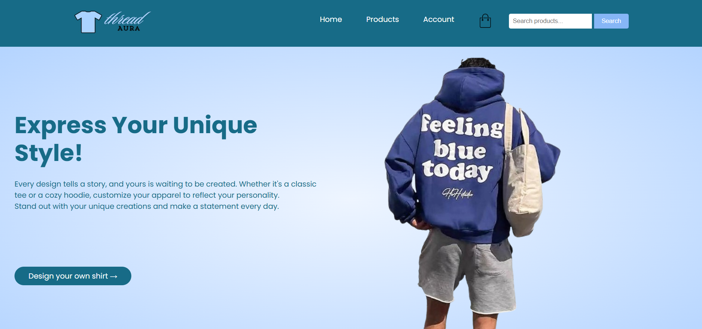
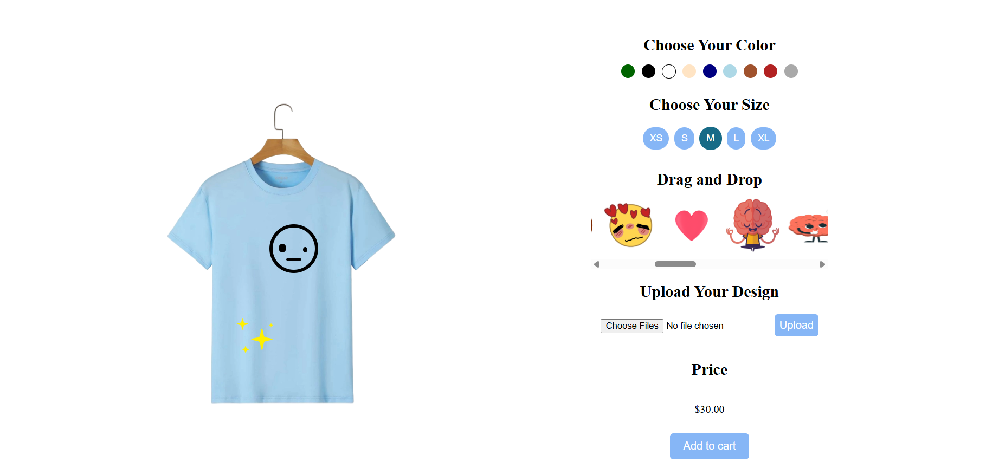

# Thread Aura — Interactive Apparel E-commerce Website

**Thread Aura** is a multi-page apparel shopping website built as a student web-development project. It combines a product catalog, T-shirt and hoodie customization pages, an account interface, a shopping cart, and a cash-on-delivery checkout prototype.

This repository preserves the **original website design and source code**, including its product images and customization graphics. It is a frontend demonstration rather than a deployed commercial store.

## Screenshots

### Homepage — Thread Aura



### T-shirt Customization



## Features

- **Storefront:** a homepage with a product search field, popular products, new arrivals, promotional offers, and brand sections.
- **Product browsing:** catalog listings, product details, and product-selection interactions.
- **Apparel customization:** dedicated T-shirt and hoodie pages with color choices, size selection, draggable design elements, and an option to upload artwork.
- **Shopping cart:** quantity controls, item removal, totals, and local shopping-cart state.
- **Account prototype:** signup and login forms with browser-based storage.
- **Checkout prototype:** address entry, shipping calculations, a cash-on-delivery option, and a locally generated order JSON file.

The functionality above describes the original coursework source. Some interactions may require bug fixes or further testing; none of these features should be treated as secure production e-commerce infrastructure.

## Technologies

- **HTML5** for markup and site structure
- **CSS3** for styling and layout
- **JavaScript** for catalog interactions, product customization, accounts, cart, and checkout
- **Browser `localStorage`** for prototype account/cart persistence
- External Google Fonts / Font Awesome resources on applicable pages

No server-side order processing, database, or real payment gateway is included.

## Original Project Structure

```text
Thread-Aura/
├── index.html                # Original homepage (entry point)
├── homestyle.css             # Homepage styles
├── home.js                   # Homepage product displays
├── products.html             # Product catalog
├── products.js               # Catalog behavior
├── productstyle.css
├── product-details.html      # Product details
├── product-details.js
├── page1.html                # Choose T-shirt or hoodie
├── Tpage.html                # T-shirt customization
├── Hpage.html                # Hoodie customization
├── account.html              # Account UI
├── accountscript.js
├── accountstyle.css
├── cart.html                 # Shopping cart
├── cart.js                   # Cart and checkout logic
├── cartstyle.css
├── checkOut.html             # Cash-on-delivery checkout prototype
├── styles.css                # Checkout styling
├── assets/                   # Original product photos and designs
├── screenshots/              # Screenshots added for documentation
│   ├── thread-aura-homepage.png
│   └── thread-aura-customization.png
└── README.md
```

Additional original files such as `Tpage.html`, `Hpage.html`, `page1.html`, and the JSON placeholders are retained without code changes.

## Running Locally

1. Clone or download this repository.
2. Open **`index.html`** in a web browser.
3. Use **Design your own shirt** to choose between the T-shirt and hoodie customization pages.
4. Use the Products, Account, and cart links to explore the other sections.

For a local development server (optional), from the repository root run:

```bash
python -m http.server 8000
```

Then visit <http://localhost:8000/>.


